# UML exercises (slide 68)

Diagrammes en Mermaid (GitHub les affiche directement).

## Exercise 1 : Hospital Management System

### Task 1 : Class diagram (basic)

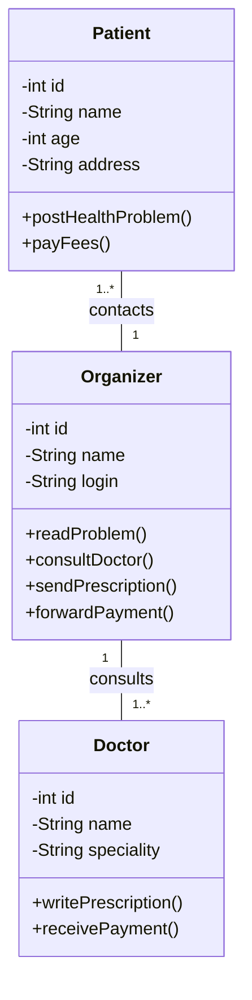

### Task 2 : Extended class diagram

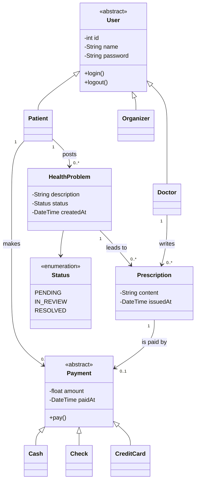

Sequence diagram : le patient soumet un probleme, recoit une prescription, paie.

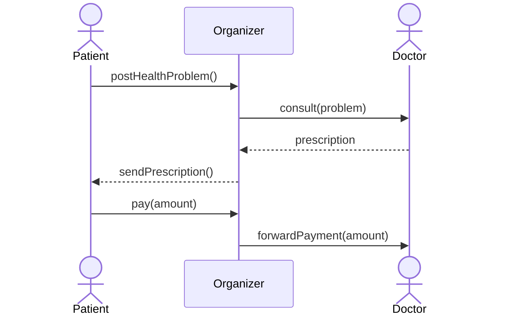

### Task 3 : Advanced

System sequence diagrams.

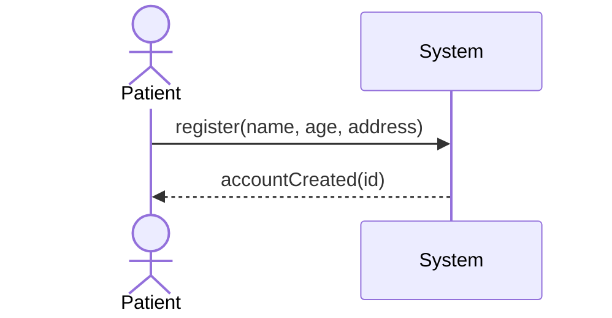

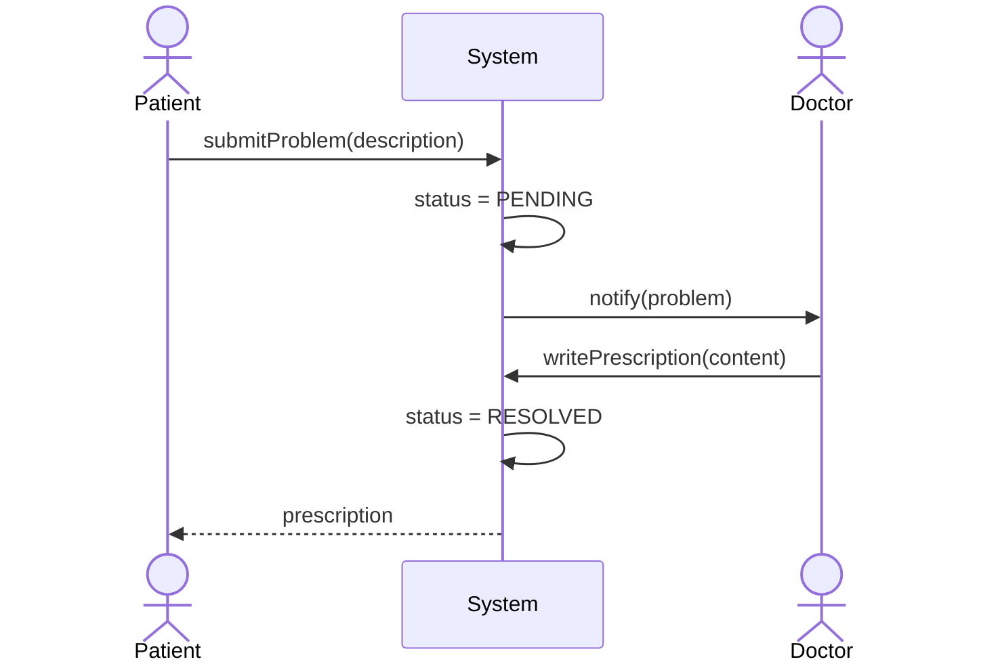

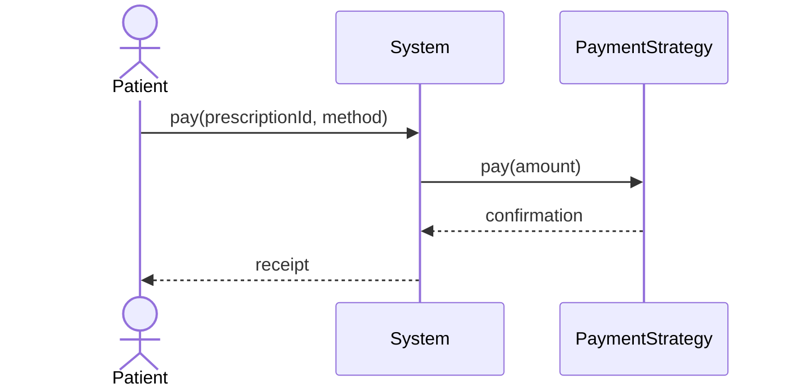

Reponses aux questions :
- **Patient avec plusieurs medecins** : association Patient 1 -- 0..* HealthProblem, chaque probleme peut avoir plusieurs Prescription de medecins differents (Doctor 1 -- 0..* Prescription).
- **Prescription reutilisable** : la prescription garde une reference vers la precedente (previous: Prescription 0..1) et un horodatage.
- **Pattern pour les paiements** : Strategy (PaymentStrategy avec Cash, Check, CreditCard).
- **Coherence des donnees de paiement** : un Payment appartient a une seule Prescription (multiplicite 0..1) et son montant est fige a la creation.

---

## Exercise 2 : ABCD Records

### Level 1

Use case diagram.

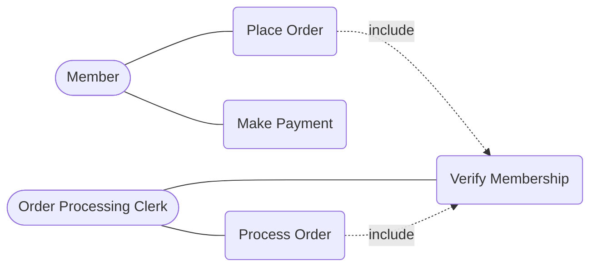

Class diagram.

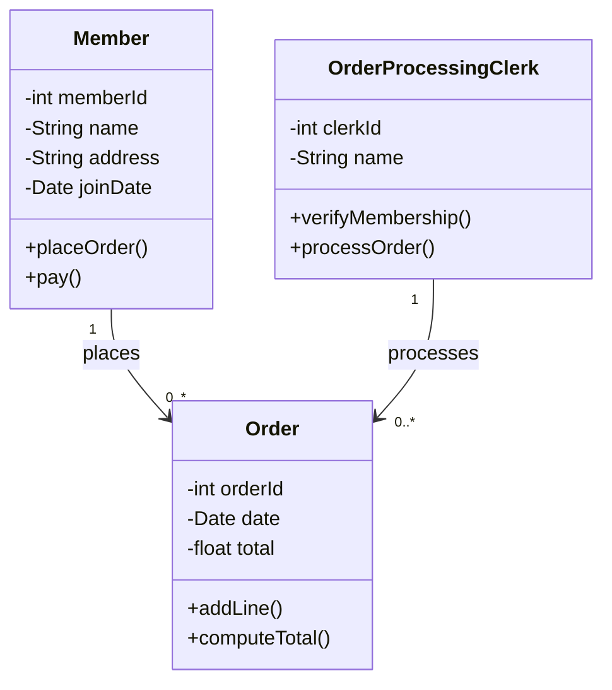

### Level 2

Use case diagram complet.

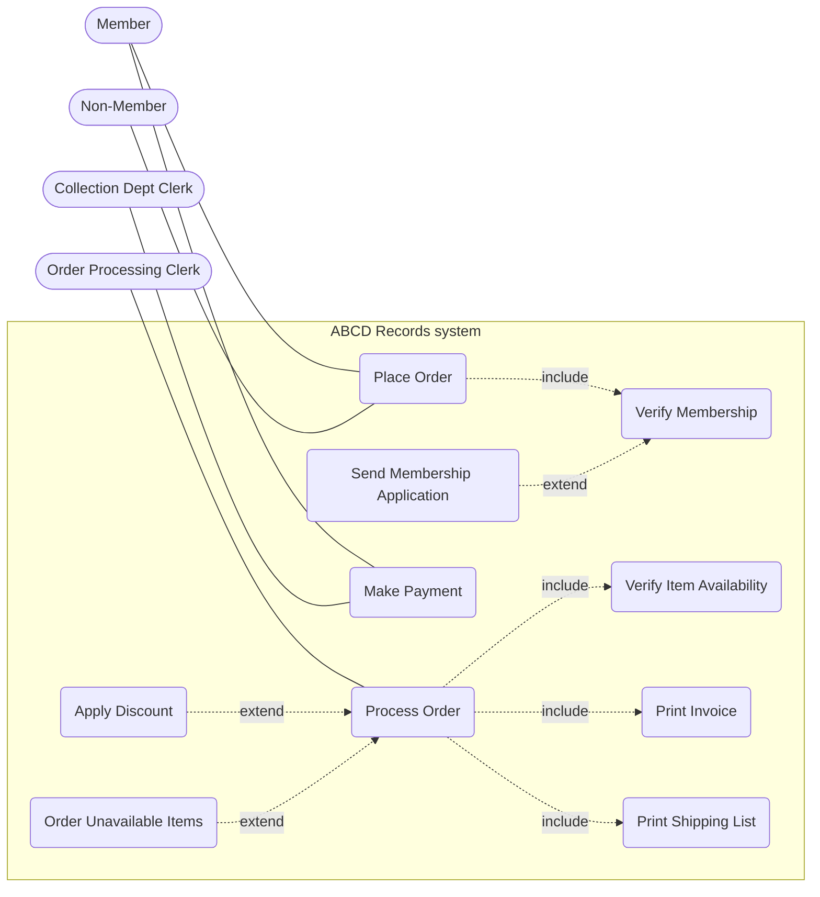

Class diagram complet.

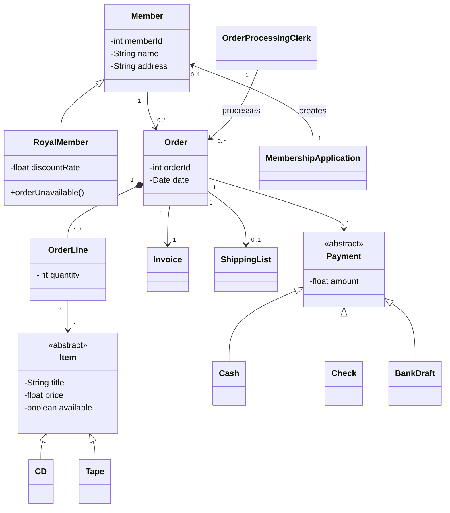

Scenario de test : un Royal member commande 2 CD (dont un indisponible) et paie par cheque.
RoyalMember -> Order avec 2 OrderLine (CD) -> l'un available = false, permis car Royal -> Payment de type Check. Le modele couvre ce cas.

### Level 3 : Sequence diagrams

Order processing flow complet.

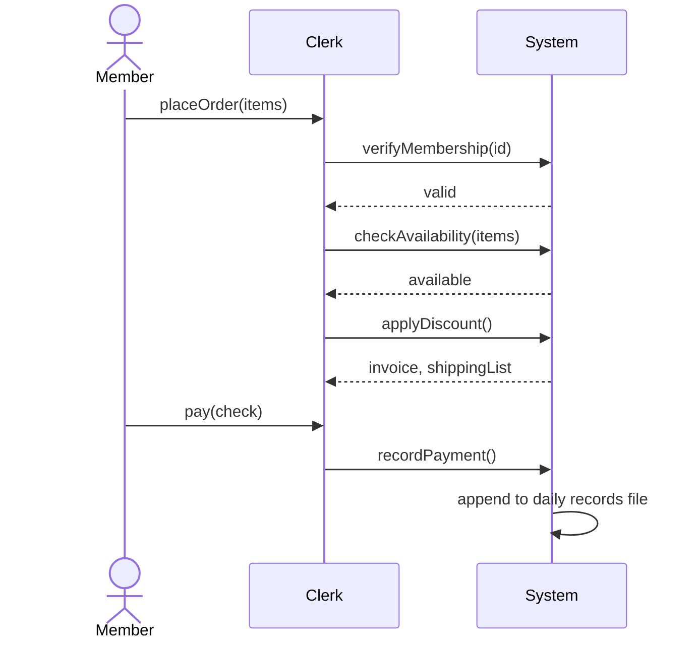

Membership verification (succes et echec).

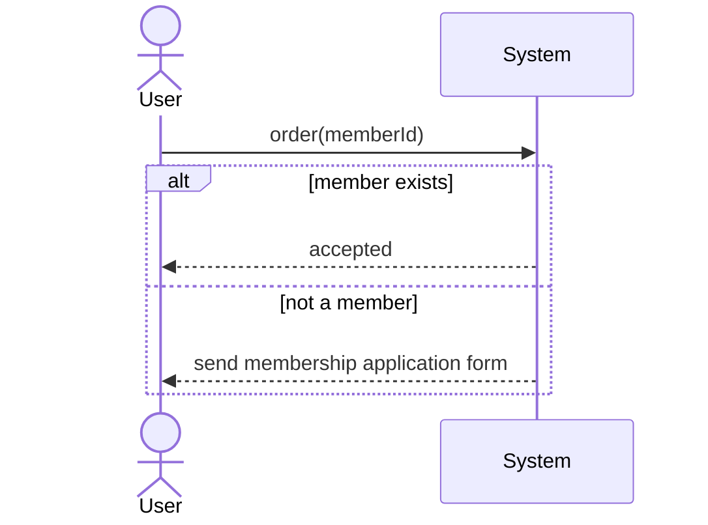

Payment processing (tous les types).

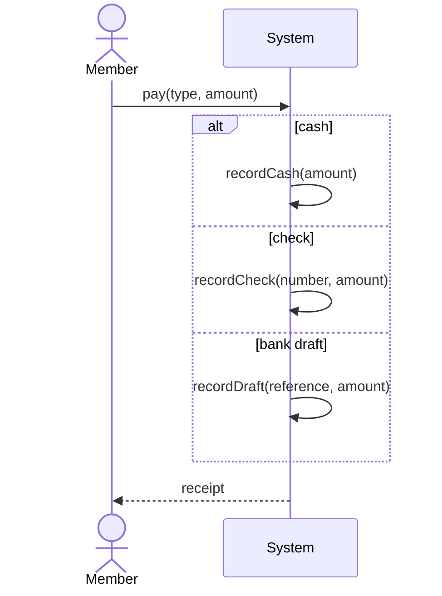

Item reordering pour les Royal members.

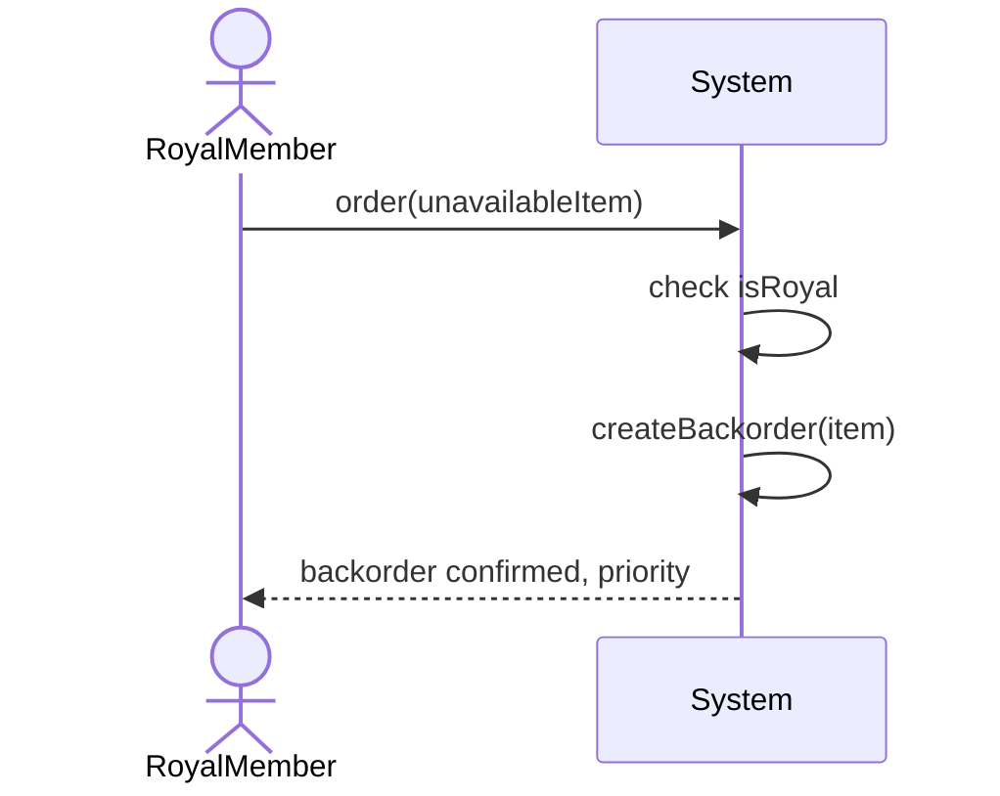
